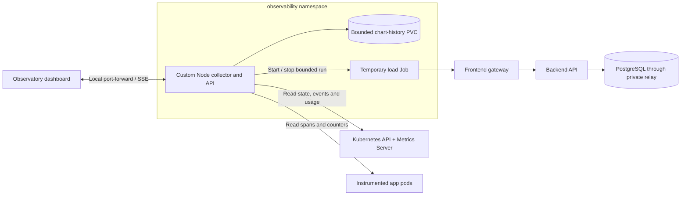

# GTA Observatory

A separate, local-first observability application for the personal GTA Kubernetes
deployment. No Prometheus, Grafana, external analytics, cloud account, npm runtime
dependencies, or applicant database credentials are required.

**Companion application and infrastructure:**
[gta-personal-infra](https://github.com/Srijan229/gta-personal-infra).

**Stack:** Node 20, browser-native JavaScript, SVG charts and animations,
Server-Sent Events, Kubernetes API, Metrics Server, and a small persistent volume.

## Architecture



The topology is a visual system map. Request waterfalls use actual correlated
spans; moving topology dots summarize sampled traffic. Those views are labelled
differently so a visual summary is not mistaken for individual packet tracing.

## Open it

Dashboard: **http://127.0.0.1:19090**

Monitored application: **http://127.0.0.1:18088**

The collector and dashboard run as one Node 20 container in the `observability`
namespace. They observe the `gta-demo` namespace and node health. This is separate
from both the professor's app repository and the `gta-personal-infra` repository.

## What the visuals mean

- **Live topology:** real health probes and sampled request rate across the client,
  frontend gateway, backend, SSH relay and Windows PostgreSQL. Moving dots summarize
  measured traffic; they are not individual packets. The dashed control path shows
  availability → custom CRD/controller → HPA → backend replica count.
- **Charts:** frontend requests/s, ready backend replicas vs policy minimum, and
  total application-pod CPU/memory. Hover chart points for timestamps and values.
  Missing metrics are gaps, never silently converted to zero.
- **Journeys:** click a recent request for correlated HTTP and Prisma operation
  spans, durations, and an offset waterfall. Click **Capture a journey** for a
  10-second, 1-request/s read-only run through the actual app.
- **Scaling intelligence:** current policy state, floor, HPA demand, and observed
  transitions. History begins when the collector starts; it is not a full audit log.
- **Load lab:** start/stop fixed-target read-only HTTP traffic. Actual sent,
  completed, failed and capacity-limited counts are shown for the latest run.
  Target rate can exceed achieved rate when requests are slow or concurrency is
  exhausted. CPU-driven HPA changes take time; the metric window is typically
  about a minute in this Minikube installation.
- **Resources:** click a topology component to filter pods; inspect usage, limits,
  restarts, deployments, services, jobs, CronJobs, and recent logs. PostgreSQL runs
  outside Kubernetes and has no pod. Its probe measures successful database
  queries, not database CPU, storage, or connection-pool internals.
- **Attention and events:** current readiness, memory-pressure, restart, probe,
  collector and error-rate issues, plus Kubernetes' recent event stream.

## Local setup and lifecycle

Prerequisites: Docker Desktop running, existing Minikube profile `minikube`,
`kubectl`, and Node 20. First start the monitored app and its private PostgreSQL
tunnel using the Minikube runbook in `../gta-personal-infra`.

```powershell
git clone https://github.com/Srijan229/gta-observatory.git
cd gta-observatory

# Build image, load it into Minikube, apply resources, start local port-forward
./scripts/local.ps1 -Deploy

# Reconnect only the dashboard port-forward after a reboot
./scripts/local.ps1

# Stop only the dashboard's owned local port-forward
./scripts/local.ps1 -Stop

# Status and logs
kubectl --context=minikube -n observability get pods,jobs,pvc
kubectl --context=minikube -n observability logs deployment/observatory
```

If Node 20 is not on PATH, pass `-NodePath 'absolute/path/to/node.exe'` to the
PowerShell script. `minikube stop -p minikube` stops this cluster's other workloads
too; it does not delete stored history.

The deployment builds directly in Minikube's container runtime to avoid exporting
large local image archives. The collector uses a dedicated service account, and
the dashboard port-forward binds only to `127.0.0.1`.

## A quick demonstration

1. Open both local URLs and wait for the green live-collection indicator.
2. Select **Capture a journey**, pick a correlated request, and examine frontend,
   backend and database operation timings.
3. Start a modest run in **Load lab**, then watch traffic, CPU and capacity charts.
4. Watch HPA desired replicas and the scaling timeline. Metrics and new replicas
   can take a minute or more to arrive.
5. Click a topology component, inspect its pods and open recent logs.
6. Stop the run and observe demand falling and eventual scale-down.

Availability changes are demonstrated by the companion infrastructure project's
`k8s-demo.mjs`; this dashboard's controls generate HTTP traffic only.

## Collection and retention

Collection runs every 5 seconds, using Kubernetes' API and existing Metrics Server.
Metrics Server supplies recent resource usage; this project performs its own
collection, counter deltas, storage, visualization, alerts and load control.
The app's chart samples are bounded at 720 (approximately one hour) and persisted
on a separate 128 MiB PVC as JSON. This small local demonstration intentionally
uses bounded file storage rather than another database server. Traces are capped
at 2,500 spans / 15 minutes in collector memory, with at most 60 recent journeys
sent to the UI. Each instrumented pod retains 600 recent spans. At high traffic,
spans may be evicted before collection, producing partial journeys.

Request counts and latency histograms use cumulative per-pod counters, with restart
and new-replica detection. First samples cannot establish rates. Percentile values
are histogram bucket upper bounds, not exact latency quantiles. Requests aborted
by clients and server failures count as errors. Ordinary HTTP 4xx are not counted
as server errors. Kubernetes CPU/memory metrics have their own scrape interval;
the dashboard's 5-second updates don't make those measurements more frequent.

## App integration

Only the **personal infrastructure container overlays** are instrumented:
`../gta-personal-infra/containers/telemetry.cjs`, `backend-bootstrap.cjs`, and
`portfolio-gateway.mjs`. No professor application source or schema is changed.

The frontend generates a random correlation ID and forwards it to the backend.
AsyncLocalStorage relates each Prisma operation to its HTTP request. The collector
reads `/telemetry` directly on backend port 3002 and frontend port 8082 inside the
cluster. There is no telemetry endpoint on the public frontend port. Raw SQL,
query arguments, request bodies, emails and profile IDs are not captured in spans;
non-allowlisted request paths are reduced to `/api/*` or `/page`.

Database operation durations include ORM and network time. We do not measure a
separate SSH transport span or internal PostgreSQL execution span. Spans use
monotonic durations and wall-clock offsets, so cross-container clock skew can
affect waterfall alignment. This is bounded demo instrumentation, not a complete
distributed tracing implementation.

After changing overlays, rebuild/load those app images and restart the frontend
and backend deployments. Reconnect the app's web port-forward if its target pod
was replaced. No repository seeds are needed.

## Permissions and controls

App-namespace access is read-only; the collector cannot read Kubernetes Secrets,
exec into application pods, patch deployments, or change HPA/CRD configuration.
Cluster-wide access is limited to node metadata/metrics. Monitoring cannot change
applicants or the active application window.

Load controls create Jobs **only in observability**, capped to 40 requests/s,
12 concurrent requests and 120 seconds, one run at a time. The URL, method and
load-job command are fixed by server code. Jobs have a deadline, resource limits,
and automatic cleanup; Stop uses foreground Job deletion. ResourceQuota bounds
the observability namespace. The collector's load-role can create Jobs within that
namespace; it is not a general-purpose multi-user authorization system.

The dashboard is a **trusted local development tool**, exposed only by a loopback
port-forward. Control requests require same-origin JSON and a per-process token;
that token prevents cross-site submissions but is not user authentication. Do not
expose it publicly without real sign-in, authorization and transport security.
Log viewing redacts common email/DB URL/bearer patterns, but cannot guarantee
removal of arbitrary secrets. Avoid logging sensitive data in the app itself.

No reference databases, imported data, seeds, AWS resources or external flows are
modified. Keys, kubeconfigs, image archives and process files stay in ignored
`.local/` folders. Changes to APIs, instrumentation and containers require Linux
runtime checks; this installation is verified inside Minikube. EKS deployment
behavior remains a separate verification step.

## Validation

```powershell
node --test test/model.test.mjs
```

Tests cover Kubernetes unit conversion, bounded load validation, and counter
resets/new replicas. The infrastructure repo also tests HTTP/database trace
correlation and removal of sensitive route/query details. Live checks cover
collection, correlation, load start/stop, duplicate rejection, control-token
rejection and Kubernetes permissions. Browser visual review must be completed
when a connected browser is available.

The final local end-to-end test observed approximately 4 requests/s, 50 correlated
journeys and zero load-generator failures in its test interval. It also verified
duplicate-run rejection, rate-bound validation, control-token rejection, load
stop, chart history surviving a restart, and Kubernetes access restrictions.
These are demonstration observations, not a performance benchmark or production SLA.

## Project structure

| Path | Purpose |
| --- | --- |
| `server/collector.mjs` | Kubernetes collection, health probes, counters, trace merging and alerts |
| `server/main.mjs` | Dashboard API, live SSE stream and guarded load controls |
| `server/model.mjs` | Kubernetes units, counter deltas and load validation |
| `server/load.mjs` | Fixed-target rate/concurrency/duration-limited load generator |
| `public/` | Responsive dashboard, SVG topology, charts and waterfalls |
| `scripts/` | Kubernetes resources and owned local lifecycle |
| `test/` | Unit conversion, load boundaries and telemetry-reset checks |

## Scope and attribution

This project implements its own collection, storage, visualization and controls.
Longer-term storage, authenticated multi-user access, broader tracing coverage,
richer log redaction, notifications and EKS-specific integration are future work.

The monitored application originates from
[retherrien/gtaApplication](https://github.com/retherrien/gtaApplication).
This repository contains the custom observability implementation; original
application source and applicant data are not included here.
